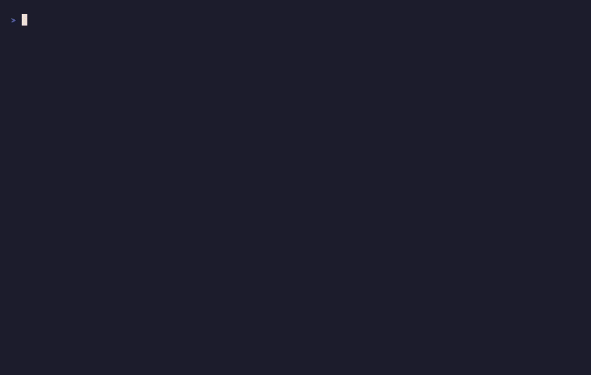

# lc-tech-exercise

Take-home exercise for the Deployed Architect, Professional Services role.

The assignment has two parts:

1. A design for a self-hosted LangSmith deployment, 
2. A multi-agent system that reviews a Terraform module before it is published. A person approves the suggested changes before a pull request is opened.



The folder structure is described below.

## `deliverables/`

The completed submission assets.

- `terraform-review-agent-demo.mp4` is a recorded demo of the Terraform Module Review agent. The file in this directory is the copy to submit. Also hosted on [Google Drive](https://drive.google.com/file/d/1kPnVRNQVGIC2BXbSxJV_VUXKBsK-ZhuP/view?usp=sharing).
- `[InnovateCorp] LangSmith Self-Hosted Design Document.pdf` is the design document.
- `presentation.pdf` is the Presentation deck.
- `langsmith-deployment.png` is the deployment diagram used in the design document and the deck.
- `module-review-v4.png` is the agent diagram used in the deck.

## `present/`

The stakeholder presentation, built with [Reveal.js](https://revealjs.com/).

`index.html` is the deck. Diagram scenes live in `assets/` next to the pictures the slides use: `langsmith-deployment.excalidraw` and `module-review-v4.excalidraw`. Lockups are the SVG files in that same folder. Exporting the deck writes `deliverables/presentation.pdf`.

## `part1/`

Source for the design document.

`[InnovateCorp] LangSmith Self-Hosted Design Document.md` is the markdown file for the Design Document and is was to build the .docx and .pdf files in `deliverables/`. 
`langsmith-deployment.excalidraw` is diagram file used to create the images in the design document.

## `part2/`

The agent code, supporting evaluations and utility scripts used during development.

The review system is in `src/review/`.

- `prompts/` holds the instructions for each specialist: interface (variables and outputs match the readme), security (Trivy findings), release (whether the module is ready, and the next version), and recommend (file edits and pull request text).
- `agents/` builds those specialists. 
  - Each agent loads its prompt and returns a structured result.
- `graph.py` defines `build_graph`. 
  - That function assembles the LangGraph: confirm the repository and ref, run interface, security, and release together, then recommend, then stop for a person to approve or decline the pull request.
- `evals.py` creates a LangSmith evaluation.

`evals/tf-module-review.json` is the dataset. `util/` has scripts for deleting LangSmith projects and datasets while developing. `tests/` covers the graph, agents, tools, and evaluators.

### How to Run

The image is `part2/Dockerfile`, which already includes all the needed tools for the agent to run.

1. Copy the example environment file, and populate the required values.

```bash
cp part2/.env.example part2/.env
```

2. Build the image.

```bash
docker build -t module-review -f part2/Dockerfile part2
```

3. Review the module from the demo, `straubt1/terraform-aws-object-storage` at `latest-variable`.

```bash
docker run --rm -it \
  --env-file part2/.env \
  -e GITHUB_REPO=straubt1/terraform-aws-object-storage \
  -e GITHUB_CANDIDATE_REF=latest-variable \
  module-review
```

The run asks before it opens a pull request.

## `demo/`

Directory holding some of the demo video transition content as well as the .gif generation for the "Agent in Action" link above.

## `details.md`

How I built this repository and produced the deliverables in an automated fashion. This is not part of the assignment but may be interesting if you are curious.

The demo reviews [straubt1/terraform-aws-object-storage](https://github.com/straubt1/terraform-aws-object-storage).