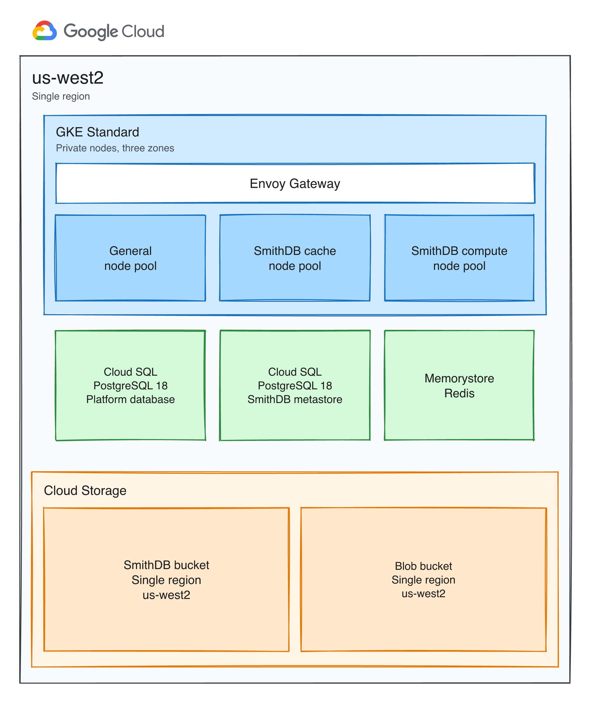

## Purpose

This document defines the infrastructure architecture for InnovateCorp's self-hosted LangSmith platform on Google Cloud. The deployment installs Helm chart 0.17.25, which deploys LangSmith application 0.17.53. It states the capabilities in scope for the initial deployment, the infrastructure required to run them, and the conditions under which that infrastructure is scaled. It is written for technical review and approval.

## Changelog

| Version | Date | Author | Notes |
| --- | --- | --- | --- |
| 0.1 | 2026-10-23 | Tom Straub | Initial Revision of Design Document - Need Customer Approval |

\pagebreak

## LangSmith Platform

Self-hosted LangSmith runs the LangSmith platform in your own infrastructure so that trace and operational data stay in your environment. This design installs Helm chart 0.17.25. The base installation includes observability, evaluation, prompt engineering, Insights, and Chat.

### Considerations

InnovateCorp already has established operations for managed Kubernetes for its own applications. LangSmith will be installed on a dedicated GKE Standard cluster in `us-west2`, with private nodes spread across three zones. 

Agent workloads remain on the existing infrastructure and submit traces to this platform. Hosting those agents on LangSmith is described under Future Considerations.

The installation is a production deployment. Durable data is held in managed services outside the cluster. Those services stay in `us-west2` and keep serving if one zone fails.

Staff sign in through InnovateCorp's OIDC provider, and agents authenticate with API keys.

The initial deployment delivers the capabilities of a standard LangSmith installation:

- **Observability.** Collection and review of traces produced by InnovateCorp's agents.
- **Evaluation.** Datasets, experiments, evaluators, and annotation of results.
- **Prompt engineering.** The playground used to develop and try prompts.
- **Chat.** Assistance for working with data already held in LangSmith.

Chat is part of that standard installation. It runs on the same cluster. It uses a database on the platform PostgreSQL 18 instance and a logical database on the Redis instance.

#### Future Considerations

A later phase can add LangSmith Deployment as maturity evolves, so that agents can be hosted and managed from this platform. Sizing for that phase is outside the scope of this document. 

The additional infrastructure is:

- KEDA (Kubernetes Event-driven Autoscaling), installed in the GKE cluster. It scales the hosted agent servers from the depth of their job queue.
- The Deployment control plane on the existing cluster: host backend, listener, and operator.
- The agent server pods that make up the data plane, scheduled on the existing GKE cluster.
- A default StorageClass backed by the GCE persistent disk provisioner, for volumes those agent servers request.

\pagebreak

### Deployment Architecture

The platform runs in one region, `us-west2`. A VPC in that region holds the GKE cluster and the managed databases. Private nodes reach Cloud Storage without public addresses.

Live data stays in `us-west2`, in the same region as the cluster.

| Store | What Google Cloud supports | This design |
| --- | --- | --- |
| Cloud SQL | The database runs in one region. High availability adds a standby in a second zone of that region. | Regional high availability in `us-west2`. The database keeps serving if one zone fails. |
| Redis | Basic tier runs in one zone. Standard tier keeps a replica in another zone of the same region and fails over to it. | Standard tier in `us-west2`. The queue keeps serving if one zone fails. |
| Cloud Storage | A bucket can be one zone, one region, two specific regions, or a multi-region such as `us`. A zonal bucket is only for Rapid storage. A regional bucket is copied across the zones of that region. A multi-region bucket is copied across regions that Google chooses, and every read is charged as data leaving the bucket. | Both buckets are regional, in `us-west2`. |

Both buckets are regional because the cluster that reads them is in one region, and a regional bucket already survives a zone failure.

If `us-west2` is down, the cluster, Cloud SQL, and Redis are down with it. A bucket in another region would not keep the platform running. Recovery is a restore from backup after the region is available again.

\pagebreak

#### Architecture Diagram

\pagebreak

| Component | Purpose |
| --- | --- |
| GKE Standard cluster | Runs the LangSmith platform on private nodes, separate from InnovateCorp's existing clusters. Autopilot is not used, because the trace store requires dedicated node pools. |
| Envoy Gateway | Publishes the LangSmith interface and API. It is the only entry point into the cluster. |
| General node pool | Runs the stateless platform services: the interface, the product APIs, the ingest workers, the playground, the runtime for custom evaluations, and Chat. |
| SmithDB cache node pool | Runs query, ingestion, and the compaction workers. Local SSD on these nodes is the cache those pods mount. |
| SmithDB compute node pool | Runs the compaction scheduler and the cluster manager. These pods coordinate maintenance and do not mount the trace cache. |
| Cloud SQL, PostgreSQL 18 | Platform database. Stores organizations, users, projects, API keys, datasets, experiments, and the Chat database. |
| Cloud SQL, PostgreSQL 18 | SmithDB metastore. Stores the catalog that records where trace data has been written. This instance is separate from the platform database. |
| Redis | Holds the ingest queue, the short-lived cache used by the platform, and Chat's queue data. |
| SmithDB GCS bucket | Holds the durable copy of traces and feedback in a regional bucket in `us-west2`. Retention is applied by compaction. Objects in this bucket are not expired by a storage lifecycle rule. |
| Blob GCS bucket | Holds large payloads and attachments in a regional bucket in `us-west2`. Short-lived objects expire after 14 days, and long-lived objects expire after 400 days. |

\pagebreak

### Scaling

The initial deployment is sized for approximately 20 concurrent users of the interface and a steady rate of approximately 100 traces per second, with bursts toward 1,000 traces per second. These are the sizes for a standard production install. SmithDB uses the medium configuration, which is intended for approximately 100 ingest requests per second and 40 query requests per second.

Further growth is absorbed first by the autoscaling ranges below. When those ranges stay saturated, the installation moves to the larger production size. That size is for approximately 50 concurrent users and approximately 1,000 traces per second.

Stateless application services scale when CPU utilization reaches 50 percent or memory utilization reaches 80 percent. The queue and ingest-queue services are also watched for work waiting in Redis. A persistent backlog there is the reason to add those workers.

| Service | Initial deployment | Larger production size | Scaling condition |
| --- | --- | --- | --- |
| frontend | 2 to 10 | 4 to 10 | Concurrent use of the web interface increases. |
| backend | 3 to 10 | 10 to 50 | Read traffic against stored traces and other API usage increases. |
| platform-backend | 2 to 10 | 5 to 20 | The rate of trace submission through the ingest API increases. |
| queue | 3 to 10 | 6 to 24 | Work waiting in the Redis ingest queue increases, or CPU utilization stays elevated. |
| ingest-queue | 3 to 10 | 6 to 24 | Work waiting in the Redis ingest queue increases, or CPU utilization stays elevated. |
| playground | 1 to 5 | 2 to 10 | Use of the playground and of model-graded evaluators increases. |
| ace-backend | 1 to 5 | 2 to 10 | The number of custom evaluation runs increases. |

The initial production size limits the backend service to 10 replicas. Sustained operation at that limit, or a persistent ingest backlog, is the condition for moving to the larger production size.

#### Sizing

| SmithDB component | Initial deployment, medium | Larger production size |
| --- | --- | --- |
| Cache nodes | `n2-standard-32` (32 vCPU, 128 GB), 4 local SSDs, up to 3 nodes per zone | `n2-standard-64` (64 vCPU, 256 GB), 8 local SSDs, up to 3 nodes per zone |
| Compute nodes | `n2-standard-8` (8 vCPU, 32 GB), up to 3 nodes per zone | `n2-standard-16` (16 vCPU, 64 GB), up to 3 nodes per zone |
| Metastore | `db-n1-standard-8` (8 vCPU, 30 GB), 50 GB disk floor, regional high availability | `db-custom-10-65536` (10 vCPU, 64 GB), regional high availability |

The general node pool uses `e2-standard-4` (4 vCPU, 16 GB). It starts at 2 nodes per zone and can grow to 10 nodes per zone when application pods cannot be scheduled. 

| Store | Initial deployment | Later growth |
| --- | --- | --- |
| Platform Cloud SQL | `db-custom-2-8192` (2 vCPU, 8 GB), 50 GB, regional high availability in `us-west2` | Remains at this machine size as trace volume grows. Disk may increase as metadata accumulates. |
| Redis | 13 GB, Standard tier in `us-west2` | Increases to 26 GB as ingest approaches 1,000 traces per second. |
| SmithDB bucket | Regional `us-west2`, with no object expiry | Grows with the volume of traces retained. Compaction reclaims data that has passed its retention period. |
| Blob bucket | Regional `us-west2`, with expiry at 14 days and 400 days | Grows with payload size, then lifecycle rules remove expired objects. |
| SmithDB local SSD | Cache on the cache-pool nodes | Rebuilt from the SmithDB bucket after a pod is replaced. It is not part of the backup. |

\pagebreak

## Open Questions

These questions came up while preparing this design. They should be answered before this document is shared with InnovateCorp and this section removed.

1. Insights is part of a base LangSmith installation but needs to enabled to operation, this design leaves it disabled. The installation guidance for Insights still requires ClickHouse, which this design does not deploy. Can Insights run with SmithDB as the only trace store? [src](https://github.com/langchain-ai/terraform/blob/843c1a1efceb223e66fc32701fd074d4639df44e/modules/gcp/helm/values/examples/langsmith-values-insights.yaml#L1)

\pagebreak

## References

1. [LangSmith self-hosted overview](https://docs.langchain.com/langsmith/self-hosted)
2. [Configure LangSmith for scale](https://docs.langchain.com/langsmith/self-host-scale)
3. [Configure SmithDB for scale](https://docs.langchain.com/langsmith/self-host-smithdb-scale)
4. [Terraform Module - GCP](https://github.com/langchain-ai/terraform/tree/v0.17.14/modules/gcp)
5. [Deploy LangSmith on GCP with Terraform](https://docs.langchain.com/langsmith/self-host-terraform-gcp-deploy)
6. [LangSmith Helm chart 0.17.25](https://github.com/langchain-ai/helm/releases/tag/langsmith-0.17.25)
7. [Prepare SmithDB supporting infrastructure](https://docs.langchain.com/langsmith/self-host-smithdb-infrastructure)

+++config
theme {
  colors = {
    page_bg              = "#FFFFFF"
    heading              = "#000000"
    body                 = "#1F2328"
    subtle               = "#656D76"
    link                 = "#0969DA"
    code_bg              = "#F6F8FA"
    code_text            = "#24292F"
    code_block_border    = "#D0D7DE"
    code_block_header_bg = "#F0F2F4"
    code_block_dot       = "#BFBFBF"
    code_syntax_keyword  = "#0550AE"
    code_syntax_builtin  = "#0550AE"
    code_syntax_function = "#0550AE"
    code_syntax_string   = "#0A3069"
    code_syntax_comment  = "#6E7781"
    code_syntax_type     = "#953800"
    code_syntax_attribute = "#126329"
    code_syntax_number   = "#0550AE"
    table_border         = "#D0D7DE"
    table_header_bg      = "#F0F2F4"
    table_stripe_bg      = "#F6F8FA"
    callout_note         = "#0969DA"
    callout_tip          = "#1A7F37"
    callout_important    = "#8250DF"
    callout_warning      = "#9A6700"
    callout_caution      = "#CF222E"
  }
  fonts = {
    heading = "TWK Lausanne"
    body    = "TWK Lausanne"
    mono    = "Menlo"
  }
}

page {
  margin_top       = 720
  margin_bottom    = 720
  margin_left      = 1200
  margin_right     = 1200
  background_color = theme.colors.page_bg
}

cover_page {
  enabled          = true
  title            = "LangSmith Self-Hosted Design Document"
  subtitle         = "InnovateCorp"
  author           = "Tom Straub"
  date             = "October 2026"
  background_image = "cover.png"
  image_style      = "background"
}

table {
  cell_padding_twips = 100
}

paragraph_style "heading1" {
  font_family  = theme.fonts.heading
  font_size_pt = 26
  bold         = true
  color        = theme.colors.heading
}

paragraph_style "heading2" {
  font_family  = theme.fonts.heading
  font_size_pt = 16
  bold         = true
  color        = theme.colors.heading
}

paragraph_style "heading3" {
  font_family  = theme.fonts.heading
  font_size_pt = 14
  bold         = true
  color        = theme.colors.heading
}

paragraph_style "body" {
  font_family  = theme.fonts.body
  font_size_pt = 12
  color        = theme.colors.body
}

paragraph_style "list" {
  font_family  = theme.fonts.body
  font_size_pt = 12
  color        = theme.colors.body
}

paragraph_style "code_block" {
  font_family  = theme.fonts.mono
  font_size_pt = 12
  color        = theme.colors.code_text
}

paragraph_style "blockquote" {
  font_family  = theme.fonts.body
  font_size_pt = 12
  italic       = true
  color        = theme.colors.subtle
}

paragraph_style "table_contents" {
  font_family  = theme.fonts.body
  font_size_pt = 12
  color        = theme.colors.body
}

character_style "inline_code" {
  font_family      = theme.fonts.mono
  font_size_pt     = 12
  color            = "#8250DF"
  background_color = "#F2EFF7"
}

character_style "hyperlink" {
  color     = theme.colors.link
  underline = true
}
+++
