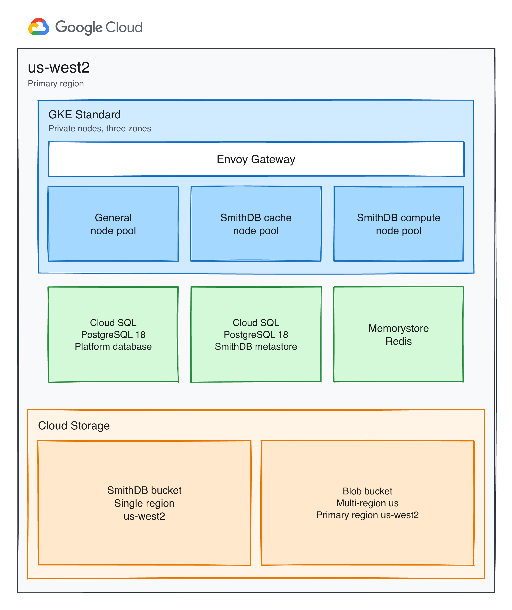

## Purpose

This document defines the infrastructure architecture for InnovateCorp's self-hosted LangSmith platform on Google Cloud. It states the capabilities in scope for the initial deployment, the infrastructure required to run them, and the conditions under which that infrastructure is scaled. It is written for technical review and approval.

## Changelog

| Version | Date | Author | Notes |
| --- | --- | --- | --- |
| 0.1 | 2026-10-23 | Tom Straub | Initial Revision of Design Document - Need Customer Approval |

\pagebreak

## LangSmith Platform

Self-hosted LangSmith runs the LangSmith platform in your own infrastructure so that trace and operational data stay in your environment. The base installation includes observability, evaluation, prompt engineering, Insights, and Chat.

### Considerations

InnovateCorp already has established operations for managed Kubernetes for its own applications. LangSmith will be installed on a dedicated GKE Standard cluster in `us-west2`, with private nodes spread across three zones. 

Agent workloads remain on the existing infrastructure and submit traces to this platform. Hosting those agents on LangSmith is described under Future Considerations.

The installation is a production deployment. Durable data is held in managed services outside the cluster. Those services are configured for high availability, and recovery from a regional failure is part of the design.

Staff sign in through InnovateCorp's OIDC provider. Agents authenticate with API keys. A local administrator account is used to complete the first login, and remains available for emergency access after OIDC is enabled. The API key salt is generated once during installation. It is not rotated, because a change would invalidate every existing API key.

The initial deployment delivers the capabilities of a standard LangSmith installation:

- **Observability.** Collection and review of traces produced by InnovateCorp's agents.
- **Evaluation.** Datasets, experiments, evaluators, and annotation of results.
- **Prompt engineering.** The playground used to develop and try prompts.
- **Chat.** Assistance for working with data already held in LangSmith.

Chat is part of that standard installation. It runs on the same cluster. It uses a database on the platform PostgreSQL 18 instance and a logical database on the existing Memorystore instance. It requires access to a model provider.

#### Future Considerations

A later phase can add LangSmith Deployment as maturity evolves, so that agents can be hosted and managed from this platform. Sizing for that phase is outside the scope of this document. 

The additional infrastructure is:

- KEDA (Kubernetes Event-driven Autoscaling), installed in the GKE cluster. It scales the hosted agent servers from the depth of their job queue.
- The Deployment control plane on the existing cluster: host backend, listener, and operator.
- The agent server pods that make up the data plane, scheduled on the existing GKE cluster.
- A default StorageClass backed by the GCE persistent disk provisioner, for volumes those agent servers request.

The Cloud SQL instance deployed for the initial phase also holds short-term and long-term memory for the hosted agents. Memorystore and the Cloud Storage buckets deployed for the initial phase continue to serve this feature.

\pagebreak

### Deployment Architecture

The platform uses `us-west2` as its primary region. A dedicated VPC in that region holds the GKE cluster and the managed databases. Where a Google Cloud product offers a multi-region configuration, this design uses it. Payload and attachment storage is a multi-region `us` bucket. The SmithDB bucket remains a single-region bucket in `us-west2`, because SmithDB requires that placement. Private nodes reach Cloud Storage without public addresses.

| Component | Purpose |
| --- | --- |
| GKE Standard cluster | Runs the LangSmith platform on private nodes, separate from InnovateCorp's existing clusters. Autopilot is not used, because the trace store requires dedicated node pools. |
| Envoy Gateway | Publishes the LangSmith interface and API. It is the only entry point into the cluster. |
| General node pool | Runs the stateless platform services: the interface, the product APIs, the ingest workers, the playground, the runtime for custom evaluations, and Chat. |
| SmithDB cache node pool | Runs the trace store processes that accept writes and serve reads. Local SSD on these nodes holds a cache for the pod that is using it. |
| SmithDB compute node pool | Runs background maintenance for the trace store, including compaction and coordination across the cache pods. |
| Cloud SQL, PostgreSQL 18 | Platform database. Stores organizations, users, projects, API keys, datasets, experiments, and the Chat database. |
| Cloud SQL, PostgreSQL 18 | SmithDB metastore. Stores the catalog that records where trace data has been written. This instance is separate from the platform database. |
| Memorystore for Redis | Holds the ingest queue, the short-lived cache used by the platform, and Chat's queue data. |
| SmithDB GCS bucket | Holds the durable copy of traces and feedback. Retention is applied by compaction. Objects in this bucket are not expired by a storage lifecycle rule. |
| Blob GCS bucket | Holds large payloads and attachments in a multi-region `us` bucket. Short-lived objects expire after 14 days, and long-lived objects expire after 400 days. |

Cloud SQL and Memorystore use private addresses on the VPC. Nodes reach Cloud Storage through Private Google Access. Pods authenticate to Cloud Storage with Workload Identity.

Both Cloud SQL instances run PostgreSQL 18, the newest major version Cloud SQL offers, and both are configured for regional high availability. Memorystore is configured for Standard high availability. The metastore stays on its own instance because SmithDB requires an empty database, separate from the platform database. Recovery from a loss of the region is a restore from backup in `us-west2`. Trace durability depends on the SmithDB object bucket and the metastore backup. The local disk used by SmithDB is a cache and is rebuilt when a pod reads data again.

\pagebreak

### Scaling

The initial deployment is sized for approximately 20 concurrent users of the interface and a steady rate of approximately 100 traces per second, with bursts toward 1,000 traces per second. These are the sizes for a standard production install. SmithDB uses the medium configuration, which is intended for approximately 100 ingest requests per second and 40 query requests per second.

Further growth is absorbed first by the autoscaling ranges below. When those ranges stay saturated, the installation moves to the larger production size. That size is for approximately 50 concurrent users and approximately 1,000 traces per second. SmithDB then uses the large configuration, intended for approximately 1,000 ingest requests per second and 100 query requests per second. The services and the SmithDB nodes are resized together.

Stateless application services scale when CPU utilization reaches 50 percent or memory utilization reaches 80 percent. The queue and ingest-queue services are also watched for work waiting in Redis. A persistent backlog there is the reason to add those workers.

| Service | Initial deployment | Larger production size | Scaling condition |
| --- | --- | --- | --- |
| frontend | 2 to 10 | 4 to 10 | Concurrent use of the web interface increases. |
| backend | 3 to 10 | 10 to 50 | Read traffic against stored traces and other API usage increases. |
| platform-backend | 2 to 10 | 5 to 20 | The rate of trace submission through the ingest API increases. |
| queue | 3 to 10 | 6 to 24 | Work waiting in the Redis ingest queue increases, or CPU utilization stays elevated. |
| ingest-queue | 3 to 10 | 6 to 24 | Work waiting in the Redis ingest queue increases, or CPU utilization stays elevated. |
| playground | 1 to 5 | 2 to 10 | Use of the playground and of model-graded evaluators increases. |
| ace-backend | 1 to 5 | 2 to 10 | The number of custom evaluation runs increases. |

Published scale guidance for this same workload recommends 16 backend replicas and 6 ingest-queue replicas. The initial production size limits the backend service to 10 replicas. Sustained operation at that limit, or a persistent ingest backlog, is the condition for moving to the larger production size.

SmithDB ingestion, query, and the compaction worker scale independently, up to 10 replicas. The compaction scheduler and the cluster manager remain a single replica. Their machine size changes when the installation moves to the large configuration.

| SmithDB component | Initial deployment, medium | Larger production size |
| --- | --- | --- |
| query, ingestion, compaction worker | 1, 1, and 1 | 4, 2, and 4 |
| compaction scheduler and cluster manager | 1 and 1, with no autoscaler | 1 and 1, on a larger machine |
| Cache nodes | `n2-standard-32` (32 vCPU, 128 GB), 4 local SSDs, up to 3 nodes per zone | `n2-standard-64` (64 vCPU, 256 GB), 8 local SSDs, up to 3 nodes per zone |
| Compute nodes | `n2-standard-8` (8 vCPU, 32 GB), up to 3 nodes per zone | `n2-standard-16` (16 vCPU, 64 GB), up to 3 nodes per zone |
| Metastore | `db-custom-6-32768` (6 vCPU, 32 GB), 50 GB disk floor | `db-custom-10-65536` (10 vCPU, 64 GB) |

The general node pool uses `e2-standard-4` (4 vCPU, 16 GB). It starts at 2 nodes per zone and can grow to 10 nodes per zone when application pods cannot be scheduled. The machine type stays the same at the larger production size. If those larger pods cannot be placed, the maximum node count is raised before the machine type is changed.

| Store | Initial deployment | Later growth |
| --- | --- | --- |
| Platform Cloud SQL | `db-custom-2-8192` (2 vCPU, 8 GB), 50 GB, regional high availability | Remains at this machine size as trace volume grows. Disk may increase as metadata accumulates. |
| Memorystore | 13 GB, Standard high availability | Increases to 26 GB as ingest approaches 1,000 traces per second. The 5 GB default applies to low write rates and is not used for this deployment. |
| SmithDB bucket | Single region, with no object expiry | Grows with the volume of traces retained. Compaction reclaims data that has passed its retention period. |
| Blob bucket | Multi-region `us`, with expiry at 14 days and 400 days | Grows with payload size, then lifecycle rules remove expired objects. |
| SmithDB local SSD | Cache on the cache-pool nodes | Rebuilt from the SmithDB bucket after a pod is replaced. It is not part of the backup. |

\pagebreak

## Open Questions

These questions came up while preparing this design. They should be answered before this document is shared with InnovateCorp and this section removed.

1. Insights is part of a base LangSmith installation but needs to enabled to operation, this design leaves it disabled. The installation guidance for Insights still requires ClickHouse, which this design does not deploy. Can Insights run with SmithDB as the only trace store? [src](https://github.com/langchain-ai/terraform/blob/843c1a1efceb223e66fc32701fd074d4639df44e/modules/gcp/helm/values/examples/langsmith-values-insights.yaml#L1)

\pagebreak

## References

1. [LangSmith self-hosted overview](https://docs.langchain.com/langsmith/self-hosted)
2. [Configure LangSmith for scale](https://docs.langchain.com/langsmith/self-host-scale)
3. [Configure SmithDB for scale](https://docs.langchain.com/langsmith/self-host-smithdb-scale)
4. [Terraform Module - GCP](https://github.com/langchain-ai/terraform/tree/v0.17.14/modules/gcp)
5. [Deploy LangSmith on GCP with Terraform](https://docs.langchain.com/langsmith/self-host-terraform-gcp-deploy)
6. [LangSmith Helm chart](https://github.com/langchain-ai/helm/tree/main/charts/langsmith)

+++config
theme {
  colors = {
    page_bg              = "#FFFFFF"
    heading              = "#000000"
    body                 = "#1F2328"
    subtle               = "#656D76"
    link                 = "#0969DA"
    code_bg              = "#F6F8FA"
    code_text            = "#24292F"
    code_block_border    = "#D0D7DE"
    code_block_header_bg = "#F0F2F4"
    code_block_dot       = "#BFBFBF"
    code_syntax_keyword  = "#0550AE"
    code_syntax_builtin  = "#0550AE"
    code_syntax_function = "#0550AE"
    code_syntax_string   = "#0A3069"
    code_syntax_comment  = "#6E7781"
    code_syntax_type     = "#953800"
    code_syntax_attribute = "#126329"
    code_syntax_number   = "#0550AE"
    table_border         = "#D0D7DE"
    table_header_bg      = "#F0F2F4"
    table_stripe_bg      = "#F6F8FA"
    callout_note         = "#0969DA"
    callout_tip          = "#1A7F37"
    callout_important    = "#8250DF"
    callout_warning      = "#9A6700"
    callout_caution      = "#CF222E"
  }
  fonts = {
    heading = "Helvetica Neue"
    body    = "Helvetica Neue"
    mono    = "Menlo"
  }
}

page {
  margin_top       = 720
  margin_bottom    = 720
  margin_left      = 1200
  margin_right     = 1200
  background_color = theme.colors.page_bg
}

cover_page {
  enabled          = true
  title            = "LangSmith Self-Hosted Design Document"
  subtitle         = "InnovateCorp"
  author           = "Tom Straub"
  date             = "October 2026"
  background_image = "cover.png"
  image_style      = "background"
}

table {
  cell_padding_twips = 100
}

paragraph_style "heading1" {
  font_family  = theme.fonts.heading
  font_size_pt = 26
  bold         = true
  color        = theme.colors.heading
}

paragraph_style "heading2" {
  font_family  = theme.fonts.heading
  font_size_pt = 16
  bold         = true
  color        = theme.colors.heading
}

paragraph_style "heading3" {
  font_family  = theme.fonts.heading
  font_size_pt = 14
  bold         = true
  color        = theme.colors.heading
}

paragraph_style "body" {
  font_family  = theme.fonts.body
  font_size_pt = 12
  color        = theme.colors.body
}

paragraph_style "list" {
  font_family  = theme.fonts.body
  font_size_pt = 12
  color        = theme.colors.body
}

paragraph_style "code_block" {
  font_family  = theme.fonts.mono
  font_size_pt = 12
  color        = theme.colors.code_text
}

paragraph_style "blockquote" {
  font_family  = theme.fonts.body
  font_size_pt = 12
  italic       = true
  color        = theme.colors.subtle
}

paragraph_style "table_contents" {
  font_family  = theme.fonts.body
  font_size_pt = 12
  color        = theme.colors.body
}

character_style "inline_code" {
  font_family      = theme.fonts.mono
  font_size_pt     = 12
  color            = "#8250DF"
  background_color = "#F2EFF7"
}

character_style "hyperlink" {
  color     = theme.colors.link
  underline = true
}
+++
