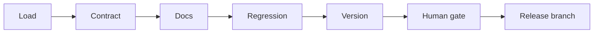

# Part 2 Module Release Plan

Each increment below is independently completable and leaves a runnable end-to-end path.

## Problem

A platform team is about to publish the next version of an AWS Terraform module. The system decides the semantic version, checks the contract and the docs, and stops for a person to approve. Approval creates a branch named `vX.Y.Z`. That branch is the release. Regression against ministack is part of the workflow shape and is not implemented yet.

This is the Part 2 agent system from [Take-Home Assignment.md](../Take-Home%20Assignment.md): LangChain and LangGraph, specialized stages, external data, a human gate, and LangSmith evaluations with custom metrics.

## Locked choices

- Python, LangGraph `StateGraph`, `init_chat_model` from `.env`, `interrupt` plus `Command` for the human gate, `InMemorySaver` with a `thread_id`.
- The module is [straubt1/terraform-aws-object-storage](https://github.com/straubt1/terraform-aws-object-storage). The checkout defaults to `/workspace/terraform-aws-object-storage` via `MODULE_PATH`. This repo does not vendor the module.
- Previous versions are git tags whose names start with `v` and match `vMAJOR.MINOR.PATCH`. Load searches `refs/tags`, ignores peeled tag refs (`^{}`), and diffs the current checkout against the highest semver tag. On this module the version tags are `v1.0.0` and `v1.0.1`, so a run from `main` baselines `v1.0.1`. `main` is the candidate, not a version tag. Tags such as `v1.2` or `v1.2.3-rc1` are ignored. A published release is still a new `vX.Y.Z` branch at the candidate sha; the next tag for baseline semver is created separately when the team tags that release.
- Ministack is already running. A later regression step will use environment variables only (`AWS_ENDPOINT_URL`, `AWS_ACCESS_KEY_ID=test`, `AWS_SECRET_ACCESS_KEY=test`, `AWS_DEFAULT_REGION`, `AWS_EC2_METADATA_DISABLED=true`). No Terraform edits and no real credentials.
- Docs-only changes produce bump `none` and do not publish a version branch.
- Removing, renaming, or retyping a variable or output, adding a required variable, or changing a default is major. Adding an optional variable or output is minor. A behavior fix that keeps the contract is patch.
- A missing description, an unmarked sensitive value, or a stale README or changelog is a blocker. Blockers do not by themselves change the bump.
- `regression.status = not_run` is shown to the human and is not treated as a pass or a failure. The basic path can still reach the release gate.
- The model never publishes. A plain node creates the `vX.Y.Z` branch only after approve or edit.

## Runtime order

Load, the human gate, and the release branch are plain Python. Contract, docs, and version are agents. Regression stays a plain placeholder until a later project.

Logical order: read the module, judge the interface, judge the docs, record that tests did not run, decide the version from all of that, then ask a person to publish the next `vX.Y.Z` branch.

## State

One `TypedDict` from the first increment, so later agents fill fields instead of reshaping the graph.

- Identity: `module_path`, `base_ref` (the highest `vX.Y.Z` tag), `candidate_ref`, `candidate_sha`, `diff_summary`, `changed_paths`
- Evidence: `interface`, `contract_findings`, `docs_findings`, `regression_findings`
- Decision: `bump` (`major`, `minor`, `patch`, `none`), `proposed_version` (the branch name, such as `v1.3.0`), `reasons`, `blockers`, `ready_for_release`, `release_notes`
- Human: `human_decision` (`approved`, `edited`, `rejected`), `human_edited_version`, `human_edited_notes`
- Result: `release_result` with status, branch name, and url only

Gold labels never go on this state. The token never goes on this state.

## Graph rules

- Increment 1 compiles the full chain. Contract, docs, and regression are pass-throughs that write an explicit not-run finding.
- Later increments replace a pass-through with an agent and leave the edges alone.
- Version is the only agent that sees every finding. Its prompt says a not-run stage was not run, and it must not invent a pass.
- Review always calls `interrupt` with the bump, proposed branch, notes, blockers, and the three finding summaries.
- Reject ends with no branch. Approve creates `proposed_version`. Edit creates `human_edited_version` and uses the edited notes. The edited name must still match `vX.Y.Z`.
- No redraft loop in the basic path.

## Release publisher and secrets

One function, `publish_release(branch, sha, notes) -> {status, url}`, called only by the release node. It creates a branch named `vX.Y.Z` at the candidate sha. It does not create a git tag.

- Dry-run and the local demo create the branch in the module checkout only. No token and no remote.
- Live publish also pushes that branch. The default publisher shells to `gh` or git. `PUBLISHER=mcp` swaps in a GitHub MCP client with the same arguments. Agents are not given either one.
- `GH_TOKEN` stays in the environment or in the MCP server config. It is not a tool argument, not in the prompt, not in checkpointed state, and not on the command line. `gh` reads the environment itself.
- Tool and trace payloads are branch, sha, and notes.
- `RELEASE_ENABLED` unset or false records `status: dry_run` and the branch that would be created. A local demo may still create that branch in the checkout. Pushing requires `RELEASE_ENABLED=true` and a token present in the environment.
- The eval target never resumes past the interrupt. The release node also refuses when `RELEASE_ENABLED` is false, so a resumed eval still cannot publish.
- `.env` stays gitignored. `.env.example` lists the variable names with empty values.

## Increments

### 1. Basic end-to-end path

Files under `src/release/`: `state.py`, `policy.py`, `graph.py`, `nodes.py`, `agents.py`, `cli.py`, plus `.env.example`.

Load reads the module at `MODULE_PATH`, selects the highest `vX.Y.Z` tag (`v1.0.1` when `main` is checked out on terraform-aws-object-storage), and records the candidate sha, changed paths, and a short diff against that tag. Pass-throughs write `{status: not_run}`. The version agent is a structured call with no tools. The CLI runs until the interrupt, asks for approve, edit, or reject, and resumes.

Done when a run on `main` prints a bump and a proposed `vX.Y.Z` branch, the human choice is resumed on the same thread, and the default result is a dry-run release record. No token required.

### 2. Live release branch

Add `publish_release` and the `RELEASE_ENABLED` guard. Cover dry-run, reject, and a refused push when the flag is off. Assert a sample token string never appears in the returned state.

Done when a local approve creates the `vX.Y.Z` branch in the checkout, a live run with the flag on pushes it through `gh` or the MCP publisher, and an eval-style run cannot.

### 3. Contract agent

Extend load to extract variables and outputs without a model. Replace the contract pass-through with an agent that has no tools. It reports unclear descriptions, sensitive values not marked sensitive, optional variables with no default, and whether a validation block is warranted. A suggestion is included only when it proposes one.

Done when those findings show up in the interrupt and the version agent cites them in blockers or reasons.

### 4. Docs agent

Run terraform-docs in plain code and put the drift on state. Replace the docs pass-through with an agent that judges whether the README, examples, and changelog match the diff. It does not re-grade description prose.

Done when a stale changelog or example becomes a blocker and a docs-only diff stays bump `none`.

### 5. Evaluation

Recommended set, enough for the assignment:

- Dataset of about ten synthetic scenarios committed as JSON. Rows cover removed variable, new required variable, new optional variable, default change, docs-only, unmarked sensitive, missing changelog, stale example, contract-stable bugfix, and a minor bump with a stale README.
- Each row has gold bump, gold blockers, and gold `ready_for_release`. Gold is read only by evaluators.
- The experiment target invokes the graph and returns at the interrupt.
- Custom deterministic evaluators: exact bump match, blocker precision and recall, ready-flag match, and a trace check that `publish_release` was not called.
- One component eval runs the version agent on frozen contract and docs findings, so a wrong bump can be blamed on the decision rather than an upstream agent.
- LangSmith project and dataset names are explicit. Tracing stays on for CLI runs.

Deeper options, designed here and built only after the recommended set is green:

- Replay ranges between `vX.Y.Z` tags from the real module when those tags follow the policy.
- Separate datasets for the contract agent and the docs agent. Description quality can add an LLM-as-judge rubric beside the deterministic sensitive and default checks. Validation snippets are graded by parse and by variable name.
- Trajectory evaluators for stage order and for every not-run status.
- Edit distance between the proposal and the human-edited notes, recorded only from real CLI sessions.
- At most two prompt variants in one LangSmith experiment.
- When regression exists, add fixture rows of normalized plan summaries. Experiments keep using fixtures so Docker is not on the eval path.

Done when `python -m evals.run_experiment` prints the recommended metrics in LangSmith and the dataset is committed.

### 6. Demo and friction log

Add `demo/script.md` for a five to ten minute recording: one happy release branch, one blocked release, the interrupt, and the LangSmith experiment. The demo uses `main` against tag `v1.0.1` in the terraform-aws-object-storage checkout. Append framework friction to `docs/friction-log.md` as it happens. Map the result to business KPIs in the presentation later: escaped breaking changes, review time per release, and releases blocked for contract or doc gaps.

## Reserved: regression

Not an increment. When it is built, a plain node will check out the highest `vX.Y.Z` tag, apply it, and plan the candidate against that state, using the running ministack and the environment variables above. The version agent will then see replacements, destroys, and apply errors. Until then the node remains the increment 1 pass-through, and the human gate shows that tests did not run.
