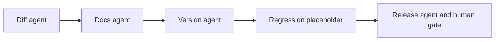

# Part 2 Module Release Plan

Each increment below is independently completable and leaves a runnable end-to-end path.

## Problem

A platform team is about to publish the next version of a public Terraform module. The system reads the last published tag, checks the docs, proposes a semantic version, and stops for a person to approve. Approval creates a GitHub Release marked draft. Regression against ministack is a placeholder and may stay that way.

This is the Part 2 agent system from [Take-Home Assignment.md](../Take-Home%20Assignment.md): LangChain agents, a LangGraph workflow, a human gate, and LangSmith cloud for traces and evaluations.

## Locked choices

- Python. The entrypoint is `python -m release.tf_module_releaser`. It loads `.env` and starts the graph.
- Each specialist is built with `langchain.agents.create_agent`. Prompts are files under `src/release/prompts/`. They are not inline strings.
- The outer workflow is a LangGraph `StateGraph` with `interrupt` and `Command` on one `thread_id`. The checkpointer is `InMemorySaver`.
- The module is the public repo [straubt1/terraform-aws-object-storage](https://github.com/straubt1/terraform-aws-object-storage), set with `GITHUB_REPO=owner/name`. The candidate ref is `GITHUB_CANDIDATE_REF` and defaults to `latest`. `main` is not the candidate. There is no local checkout on this path.
- Published versions are git tags named `vMAJOR.MINOR.PATCH`. The diff agent will compare the highest of those tags to the candidate ref. Tags such as `v1.2` or `v1.2.3-rc1` are ignored.
- Public reads use the GitHub HTTPS API and do not send a token. `GH_TOKEN` is used only by the draft-release tool, and only after that tool is implemented. It is not a tool argument, not in a prompt, and not on graph state.
- A draft GitHub Release is the publish action. The releaser does not create a `vX.Y.Z` branch.
- The version agent chooses `major`, `minor`, or `patch` from the diff. A breaking contract change is major. A backward-compatible addition is minor. A behavior fix that keeps the contract is patch. Regression output is not an input until that agent exists.
- `regression_findings.status = not_run` is shown to the human. It is not a pass and it is not a failure.
- The model never publishes. After approve, a later increment may call `create_draft_release`. Reject creates nothing.
- Observability and evals go to LangSmith cloud (`https://api.smith.langchain.com`). Tracing turns on only when `LANGSMITH_TRACING=true` and both `LANGSMITH_API_KEY` and `LANGSMITH_PROJECT` are set. The eval dataset name is `tf-module-release`.

## Runtime order

Diff, docs, version, and release are `create_agent` graphs. Regression is a plain node. The release node interrupts before any publish tool. Resume is `approved` or `rejected` on the same thread.

## State

One `TypedDict`, so later increments fill fields instead of reshaping the graph.

- Identity: `repo`, `candidate_ref`, `base_ref`, `candidate_sha`, `diff_summary`, `changed_paths`
- Docs: `docs_ready`, `docs_findings`
- Decision: `bump` (`major`, `minor`, `patch`), `proposed_version`, `reasons`, `release_notes`
- Regression: `regression_findings`
- Human: `human_decision` (`approved`, `rejected`)
- Result: `release_result` with `status`, `tag`, and `url`

Gold labels never go on this state. The token never goes on this state.

## Agents

| Agent | Tools | Prompt | This stub |
| --- | --- | --- | --- |
| Diff | `list_version_tags`, `compare_refs` | `prompts/diff.md` | Built, not invoked. Writes a stub summary. |
| Docs | `read_repo_file` | `prompts/docs.md` | Built, not invoked. Writes a stub finding. |
| Version | none | `prompts/version.md` | Built, not invoked. Writes an empty bump. |
| Regression | none | none | Placeholder. Status `not_run`. |
| Release | `create_draft_release` | `prompts/release.md` | Built only after approve. The tool is not called. |

Tool bodies return `not implemented` and do not call GitHub.

## Increments

### 1. Runnable stub

Files under `src/release/`: `tf_module_releaser.py`, `graph.py`, `state.py`, `config.py`, `agents/`, `tools/`, `prompts/`, `observability.py`, `evals.py`.

The CLI runs until the interrupt, asks for approve or reject, and resumes. Approve records `status: stub`. Reject records `status: rejected`. Neither creates a draft release. `evals.run_experiment` names the LangSmith cloud dataset and raises until a later increment.

Done when `uv run pytest` passes and `uv run python -m release.tf_module_releaser` reaches the human gate without a token.

### 2. Diff agent

Invoke the diff agent. Implement `list_version_tags` and `compare_refs` against the public GitHub HTTPS API. No token. Record the highest `vX.Y.Z` tag, the candidate sha, changed paths, and the summary.

Done when a run against `straubt1/terraform-aws-object-storage` fills `base_ref` and `diff_summary` from `v1.0.1` to `latest`.

### 3. Docs agent

Invoke the docs agent. Implement `read_repo_file`. It checks that the README documents variables and outputs and that a CHANGELOG is present at the candidate ref.

Done when those findings show up in the interrupt.

### 4. Version agent

Invoke the version agent with structured output and no tools. It reads the diff summary and chooses `major`, `minor`, or `patch`. It must not treat regression `not_run` as a pass.

Done when the interrupt shows a bump and a proposed `vX.Y.Z` tag.

### 5. Draft release

Call `create_draft_release` only after approve, and only when `RELEASE_ENABLED=true` and `GH_TOKEN` is present in the environment. The tool creates a GitHub Release with `draft: true`. The token is read inside the tool. A missing flag records a dry run and does not call GitHub. The eval target never resumes past the interrupt.

Done when a local approve with the flag off creates nothing, and a live run with the flag on opens a draft release.

### 6. LangSmith evaluations

Dataset `tf-module-release` on LangSmith cloud, about ten rows: removed variable, new required variable, new optional variable, default change, docs-only, missing changelog, missing README outputs, contract-stable bugfix, and a minor bump with a stale README.

Custom evaluators: exact bump match, docs-ready match, and a trace check that `create_draft_release` was not called. The experiment target invokes the graph and returns at the interrupt. One component eval runs the version agent on a frozen diff summary.

Done when `python -m release.evals` prints the metrics from LangSmith cloud and the dataset is committed.

## Reserved: regression

Not an increment. If it is built, it will plan the candidate against the highest published tag using ministack and the AWS endpoint environment variables in `AGENTS.md`. Until then the node stays the increment 1 placeholder, and the human gate shows that tests did not run.
