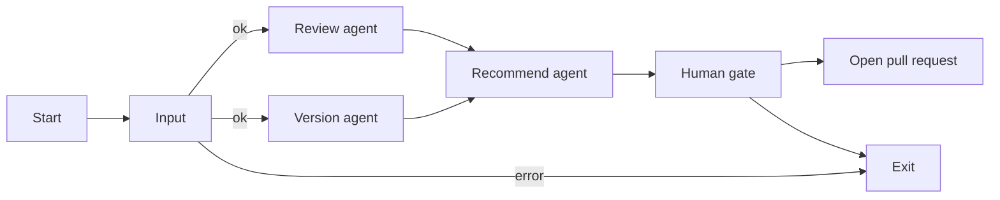

# Part 2 Module Review

Part 2 of [Take-Home Assignment.md](Take-Home%20Assignment.md). The domain is a Terraform module that is about to be published. Two agents read the public GitHub repo in parallel. A third agent prints what they found and stops for a person, who decides whether those suggestions become a pull request.

Default repo: `straubt1/terraform-aws-object-storage`. Default ref: `latest`. Published versions are git tags `vMAJOR.MINOR.PATCH`.

Each step below is implemented in order and leaves a runnable path.

## Shape



Input checks that `repo` and `ref` are set, then confirms that ref with one commit lookup. It does not download the repository. On failure it prints the error and the graph ends. Review and version start together only after that check. Recommend runs after both have written their results. The human gate is a LangGraph `interrupt`, not a fourth agent.

The same flow is drawn in [plans/diagrams/module-review.excalidraw](diagrams/module-review.excalidraw).

## Locked choices

- Python package `review`, in `part2/`. Run it with `uv run --directory part2 python -m review`.
- LangChain `create_agent` for the three agents. LangGraph `StateGraph` for the outer flow. `init_chat_model` reads `MODEL` (`provider:model`).
- Graph state is a `TypedDict`. Agent outputs use a plain JSON schema dict passed as `response_format`. We do not define Pydantic models.
- Prompts are files in `part2/src/review/prompts/`.
- GitHub reads go through one reader used by the tools. The live reader calls the public HTTPS API. Tests and evals pass a fixture reader with the same three methods, so the agents do not care where the bytes came from.
- `GH_TOKEN` is read from the environment inside the reader and inside the pull-request function. It is not a tool argument, not in a prompt, and not on graph state. Reads omit the header when the variable is unset.
- LangSmith tracing is on when `LANGSMITH_TRACING=true` and both `LANGSMITH_API_KEY` and `LANGSMITH_PROJECT` are set. Endpoint stays `https://api.smith.langchain.com`. The dataset name is `tf-module-review`.

## State

```python
class Finding(TypedDict):
    filename: str
    finding: str

class ProposedFile(TypedDict):
    filename: str  # README.md or CHANGELOG.md
    content: str

class FoundVersion(TypedDict):
    version: str       # vX.Y.Z
    published: bool    # true when a git tag of that name exists
    source: str        # tag, CHANGELOG.md, README.md, or another file

class State(TypedDict):
    repo: str
    ref: str
    review_status: str          # "pass" or "fail"
    review_findings: list[Finding]
    suggested_version: str      # vX.Y.Z
    versions: list[FoundVersion]
    version_findings: list[Finding]
    suggestions: str            # text printed for the person
    proposed_files: list[ProposedFile]
    decision: str               # "" then "yes" or "no"
    pr_url: str
```

Review and version write different keys, so the parallel branches do not need a reducer.

## Agents

### Review

Copies the candidate ref once, then reads that copy. Favors `*.tf` files and also treats `variable` and `output` blocks in any other filename as module interface. Compares those blocks with `README.md`, and checks that `CHANGELOG.md` describes the work on this ref.

- Every variable and output name appears in the README, with the same type, description, and default.
- The changelog's top section covers the changes since the last published tag, or it matches that tag when nothing has changed.
- `examples/` waits for a later round.

Returns `status` (`pass` or `fail`) and `findings` (`filename`, `finding`). A finding means `fail`.

### Version

Reads the tags named `vX.Y.Z` and the compare diff against the highest tag. It does not copy the repository. Ignores tags and strings that are not `MAJOR.MINOR.PATCH`. A version string counts when it appears in that diff.

A version is published when a git tag uses that name. A version is unpublished when it shows up in `CHANGELOG.md`, `README.md`, or another file and no tag uses that name. The same version found in more than one place is one entry: `published` is true if any place is a tag, and `source` lists every place.

Compares the ref to the highest tag and returns `bump` as `major`, `minor`, or `patch` (`none` when nothing changed). The next number is computed from that tag and the bump.

Hard: no change stays on the tag. A breaking variable or output change is `minor` or `major`, never `patch`. A new optional variable or output is `patch` or `minor`, never `major`. A patch stays backward compatible. A major bump is not backward compatible.

Soft: inside those bands, the model chooses the level and cites the diff. If more than one level matches, it chooses the highest.

Returns `suggested_version` (`vX.Y.Z`), `versions`, and `findings`. `versions` is every version found, each with `version`, `published`, and `source`. The suggestion is included there only when the repo already mentions it. A changelog heading that disagrees with the tags or with the diff is a finding. The suggested version is computed from the highest tag and the diff.

### Recommend

Runs only after both results are in state. It writes `suggestions` (a short report: review status, suggested version, every found version with published or unpublished, and findings) and `proposed_files` (full text of `README.md` and `CHANGELOG.md` only). It does not call GitHub.

The next node prints `suggestions` and interrupts with: create a pull request with these suggestions? Resume value is `yes` or `no`.

- `no`: store the decision and exit.
- `yes`: open one pull request. Base ref is `ref`. Head branch is `review/<suggested_version>-<6 alphanumeric characters>`. Title and body use the status, version, and findings. The commit contains only the proposed `README.md` and `CHANGELOG.md`. If `proposed_files` is empty, exit without calling GitHub, because a pull request needs a diff.

## Step 1 — Frame the package and the graph

Add the package and a graph that runs from start through the human gate.

```
part2/src/review/
  __init__.py
  __main__.py
  graph.py
  state.py
  reader.py
  agents/review.py
  agents/version.py
  agents/recommend.py
  tools/github.py
  prompts/review.md
  prompts/version.md
  prompts/recommend.md
part2/tests/test_graph.py
```

- `reader.py` defines the three reads the tools will use: `read_file(path, ref)`, `list_release_tags()`, `compare(base, head)`. No HTTP yet. The graph is constructed with a reader.
- Each agent module exposes `build(model, tools)` and returns `create_agent(...)` with a `name` (`review`, `version`, `recommend`), the prompt file, and that agent's JSON schema.
- `graph.py` fans out from `START` to `review` and `version`, then both edges go to `recommend`, then to `gate`. Checkpointer is `InMemorySaver`. `gate` calls `interrupt` and stores `yes` or `no`.
- `__main__.py` loads `.env`, requires `MODEL`, invokes the graph, prints the interrupt payload, and resumes with stdin.
- Point `part2/langgraph.json` at `src/review/graph.py:graph`. Update `part2/.env.example` and the `part2/pyproject.toml` description. Drop the direct `pydantic` dependency. Set `LANGSMITH_PROJECT` to `terraform-module-review`.
- `part2/tests/test_graph.py` builds the graph with a fake chat model and a fixture reader. It asserts both branches finish, the gate interrupts, `no` ends with `decision=no`, and `yes` ends with `decision=yes` without a pull request.
- Draw the high-level flow in `plans/diagrams/module-review.excalidraw` and export `plans/diagrams/module-review.png` beside it. The picture shows start, review and version in parallel, recommend, the yes/no gate, the pull request, and exit.

Done when `uv run --directory part2 pytest tests/test_graph.py` passes, `uv run --directory part2 python -m review` reaches the yes/no prompt, and the diagram matches this flow.

## Step 2 — Review agent and version agent

Implement the live reader with the GitHub HTTPS API (stdlib only) and give both agents their tools: `read_file`, `list_release_tags`, `compare`.

Fill in the three prompt files with the rules in [Agents](#agents). Review and version each get one user message: repo, ref, and what to return. They fetch files themselves so the LangSmith trace shows the tool calls.

After each agent returns, copy `structured_response` onto the graph state. If review findings is non-empty, set status to `fail`.

Extend `part2/tests/test_graph.py` with a fixture reader and the fake model, covering one passing module and one module whose README omits a variable. Assert status, finding filename, suggested version, and the `versions` list. One fixture has a published tag. One has a changelog heading with no matching tag, returned as unpublished with source `CHANGELOG.md`.

Done when a live run against `straubt1/terraform-aws-object-storage` at `latest` prints a review status, a `vX.Y.Z`, every found version with published or unpublished, and any findings, and the fake-model tests pass.

## Step 3 — Recommend agent, human gate, and pull request

Fill in the recommend prompt. Its input is the review and version results already on state. Its schema is `suggestions` plus `proposed_files`.

`gate` prints `suggestions`, then interrupts. On `yes`, `open_pull_request` in `tools/github.py` reads `GH_TOKEN` from the environment and opens the pull request described above. On `no`, it returns.

Add a test that resumes with `yes` against a fake opener and checks the branch name, the body, and that only `README.md` and `CHANGELOG.md` are committed. Resume with `no` and check that the opener is not called.

Done when a live run prints the report, accepts `yes` or `no`, and a `yes` with a token opens one pull request.

## Step 4 — LangSmith evaluations and performance metrics

Add `part2/evals/tf-module-review.json`. Each example is a fixture reader payload (files at the last tag and at `latest`, plus tags) and the expected `review_status`, `suggested_version`, finding filenames, and `versions` (`version` plus `published`).

Cover at least:

- Docs and changelog match, no diff: pass, same version, no findings.
- Optional variable added, README stale: fail, finding on `README.md`, minor bump.
- Required variable added, changelog notes the break, README updated: pass, major bump.
- Output renamed, README still lists the old name: fail, finding on `README.md`, major bump.
- Changelog heading still on the last tag while the ref has a fix: fail or a version finding, patch bump.
- No `vX.Y.Z` tags yet: suggested `v1.0.0` when the changelog has no version.
- Changelog heading `1.2.0` and no tag: `versions` includes `v1.2.0` with `published` false.

`part2/src/review/evals.py` runs `langsmith.evaluation.evaluate` on the graph with the fixture reader. Four evaluators, all plain functions, score 1 or 0:

- `review_status` — exact match.
- `suggested_version` — exact match.
- `finding_files` — the set of filenames matches. Extra or missing files score 0.
- `versions` — the set of `version` and `published` pairs matches.

An example passes only when all four scores are 1. `part2/tests/test_evals.py` calls `evaluate` and fails the pytest run otherwise. The same test prints median latency and token counts from the experiment, grouped by agent name (`review`, `version`, `recommend`). Those run stats are the performance metrics.

Also unit-test the four evaluators with hand-written outputs so a scoring mistake fails without a network call.

Done when `uv run --directory part2 pytest` passes, the `tf-module-review` experiment is in LangSmith, and the traces show both parallel agents, the tool calls, and the human gate.
